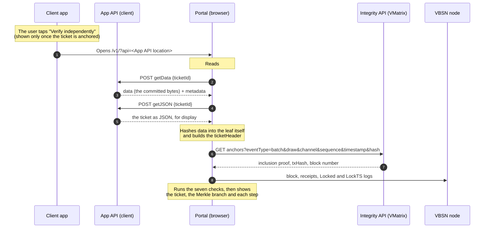

# Verification portal: integration guide

The verification portal is a static web page that lets anyone check a ticket
against the chain, in their own browser. No server reaches a verdict: the
portal fetches the ticket from the client that sold it, fetches the proof from
the Integrity API, reads the block from a VBSN node, and runs every check
itself. A client that returns wrong data, or an Integrity API that returns a
wrong proof, makes the check fail; it cannot make it pass.

This guide covers what a client (the party that commits tickets, for example
3D) builds so that its users can verify their tickets: the App API, the
verification link, the ticket format, and the evidence file. The design it
implements is the [proposal](portal.md), sections 3.1 to 3.3.

## Contents

- [Status](#status)
- [How a check runs](#how-a-check-runs)
- [What a client provides](#what-a-client-provides)
- [Registering with the portal](#registering-with-the-portal)
- [The verification link](#the-verification-link)
- [App API](#app-api)
- [The ticket and its leaf](#the-ticket-and-its-leaf)
- [Anchoring so that the portal can verify](#anchoring-so-that-the-portal-can-verify)
- [What the portal checks](#what-the-portal-checks)
- [Evidence file](#evidence-file)
- [Trying it on staging](#trying-it-on-staging)

## Status

| Part | State |
|---|---|
| Portal checks, link with `api` and `#id`, App API calls, evidence files | Running on staging |
| App API | Specified here; staging uses a demo App API until the client's own is live |
| Integrity API route for the portal (lookup by `ticketHeader`, no client key, CORS) | Proposal 3.3. Not yet on the tracing backend; staging uses a stand-in that reads the same index |
| SDK links (`?type=batch&…#ticketId=…`) | Built by the .NET SDK. **Not accepted by the portal yet**; the format is being agreed (see [SDK links](#sdk-links-not-accepted-yet)) |
| `timestamp` in `batchHeader` | Proposal 3.3. The tickets plugin does not accept the field yet |

## How a check runs



The user can also open the portal and pick an evidence file (`.json`) that the
client app exported. The file carries everything, so that check runs offline.

## What a client provides

| What | Why |
|---|---|
| A signing key for tickets (ES256, P-256) | The portal checks the client's signature on each ticket |
| An App API | The portal fetches the committed bytes and the display JSON from it |
| A way to issue a `ticketId` per check | The link carries it; the App API accepts it |
| The "Verify independently" button | Opens the verification link in the system browser |
| An evidence file export (recommended) | Lets the user verify offline, or on the auditor's copy of the portal |
| Batches anchored as described [below](#anchoring-so-that-the-portal-can-verify) | The portal checks the ticket against what is on chain |

## Registering with the portal

The portal only talks to clients listed in its **directory**, so a link cannot
point the portal at an unlisted server. In the production build the directory
is built into the page (it is part of the published build hash), and adding or
changing a client means a new portal build; the staging demo reads it from the
demo server. Send VMatrix:

| Field | Example | Notes |
|---|---|---|
| `id` | `3D` | Your committer id. Every `getData` answer carries it as `metadata.committer` |
| `name` | `3D` | Shown to users as the party that recorded the batch |
| `appApi` | `https://api.example.com/portal/` | Your App API location. HTTPS, ends with `/` |
| `registries` | `0x953d…1fd3` | Your anchoring contract(s), from `GET /api/contract` |
| `accounts` | `0x…` | The accounts that send your anchoring transactions |
| Issuer public key | P-256 point (65 bytes) or SPKI, hex | Verifies the signature on your tickets |

The portal identifies who recorded a batch by the contract that emitted the
`Batched` log. A contract that is not in the directory is shown as "not
registered", and a batch from another client's contract fails the check.

## The verification link

```
https://<portal>/v1/?api=<App API location>#id=<ticketId>
```

| Part | Where | Content |
|---|---|---|
| `api` | Query | Your App API location, URL-encoded. It must match the directory entry exactly (scheme, host, path, trailing `/`) |
| `id` | After `#` | Your `ticketId`, URL-encoded. The portal treats it as opaque and passes it to your App API unchanged |

- Open the link in the system browser, not a web view inside your app, so that
  the user sees the portal's own address.
- The part after `#` never reaches a server. The portal reads it and removes
  it from the address bar and history right away.
- A link opens once. Reloading the page, or opening it again, needs a new
  `ticketId` from your app.
- Line breaks and spaces added when a link is copied are ignored. `+` in a
  `ticketId` is kept as `+`.

### SDK links (not accepted yet)

The .NET SDK builds links of this form:

```
https://<portal>/v1/?type=batch&draw=…&channel=…&sequence=…&ticketHash=0x…#ticketId=…
https://<portal>/v1/?type=lock&draw=…&key=0x…
```

The portal does not read these links yet. They carry no App API location, so
the portal could not fetch the ticket for a `batch` link. Until the format is
agreed, build links in the form above.

## App API

Two functions, both `POST` with JSON, at your App API location:

```
POST <appApi>getData   {"ticketId": "<ticketId>"}
POST <appApi>getJSON   {"ticketId": "<ticketId>"}
```

The `ticketId` goes in the body, never in the path or the query, so that it
does not reach server logs or proxies.

### `getData`

Returns the exact bytes that were hashed into the leaf, and how to read them.

```json
{
  "data": "<standard base64 of the COSE_Sign1 ticket>",
  "metadata": {
    "format": "cose",
    "namespace": "MEGA-01459",
    "stream": "M",
    "committer": "3D",
    "display": "json",
    "sequence": 1234,
    "timestamp": 1793079345000
  }
}
```

| Field | Rule the portal applies |
|---|---|
| `data` | Standard base64 (not base64url). The portal hashes these bytes and nothing else |
| `metadata.format` | Must be `cose`. Other formats are not supported yet |
| `metadata.namespace` | Must equal the draw key of the ticket, for example `MEGA-01459` (see [the ticket](#the-ticket-and-its-leaf)) |
| `metadata.stream` | Must equal the ticket's `channel` |
| `metadata.committer` | Must equal your directory `id` |
| `metadata.display` | `json`: the portal calls `getJSON` and compares it with `data` |
| `metadata.sequence` | The ticket's own number (see [Numbering ticket batches](../reference/batch-numbering.md)). Integer |
| `metadata.timestamp` | The ticket's time, milliseconds since 1970 UTC. Integer |

The portal does not trust `metadata`: `sequence` and `channel` are checked
again against the `Batched` log on chain, after the proof.

### `getJSON`

Returns the ticket as JSON: the same object as the TicketJSON of `data` (see
below). The portal compares the two after canonical JSON (RFC 8785) and
reports a mismatch if they differ. It shows this JSON to the user.

### Errors

| Case | Status | The portal shows |
|---|---|---|
| Unknown `ticketId` | `404` | "Not found" |
| `ticketId` expired or already used | `410` | "The link has expired, open it again from the app" |
| Data deleted at the user's request or past its retention | `410` with `{"reason": "…"}` | "The original data is no longer kept"; the evidence file still works |
| Too many calls | `429` | "Try again later", with a retry button |
| `5xx`, network error | | "The client is not responding", with a retry button |

### Access rules

- **CORS:** allow the portal's origin (and the auditor's copy) for `POST` with
  the `content-type` header, and answer the preflight `OPTIONS`.
- **`ticketId`:** make it unguessable, single-use and short-lived, for example
  a random access code issued when the user taps the button, valid for five
  minutes. The portal calls `getData` once and `getJSON` once per `ticketId`.
- **One ticket per call:** no listing or search function.
- **Rate limit** per IP; answer `429` above it.

## The ticket and its leaf

A ticket is a **COSE_Sign1** structure (RFC 9052):

- algorithm ES256 (`-7`) in the protected header, signature on P-256, 64 bytes,
  **low-S**;
- the payload is a CBOR map in **deterministic encoding** (RFC 8949
  section 4.2.1): shortest lengths, sorted keys, no indefinite lengths, no
  floats. The portal rejects other encodings, because they do not hash to a
  single leaf.

Fields of the payload the portal reads:

| Field | Type | Notes |
|---|---|---|
| `vietlottCode` | string | Ticket code |
| `product` | string | For example `MEGA645` |
| `drawId` | string | For example `01459`. With `product`, it makes the **draw key** `MEGA-01459` |
| `numbers` | int[] | The selection |
| `amount` | uint | Price |
| `channel` | string | Sales channel; the batch carrying the ticket must use the same channel |

Other fields (`issuedAt`, `partnerId`, `holder_commit`, …) are shown as they
are.

**TicketJSON** is the payload converted to JSON: strings, integers, arrays and
maps stay as they are, byte strings become lowercase `0x` hex. The leaf is:

```
leaf = keccak256( 0x00 || JCS(TicketJSON) )
```

JCS is RFC 8785. The leaf does not depend on the signature, so re-signing a
ticket keeps its leaf.

## Anchoring so that the portal can verify

Send batches as described in [Tickets](tickets.md), with:

- `ticketHashes`: the leaves above, in ticket-number order;
- `draw`: the draw key (`MEGA-01459`);
- `channel`: the ticket's `channel`;
- `sequence`: the number of the batch's first ticket, so that ticket *k* of the
  batch (from 0) is number `sequence + k`, the number `getData` reports;
- the lock and its timestamp (`lock`, `lockts`) at the close of sales.

## What the portal checks

| Step | Check |
|---|---|
| 1 | The client's signature on the ticket is valid (ES256, low-S, key in the directory) |
| 2 | The leaf computed from the ticket, with the proof, leads to the `ticketRoot` of the batch |
| 3 | The `Batched` log is in the transaction, the transaction and its receipt are in the block (transactionsRoot, receiptsRoot), and the batch is for the ticket's draw |
| 4 | The transaction was sent by one of the client's registered accounts, not revoked at that block |
| 5 | The block carries commit seals of at least 2/3 of the pinned validators (4 of 5) |
| 6 | The draw is locked, and the batch's block is not after the draw's root block |
| 7 | The lock's RFC 3161 timestamp is before the draw time |

Then, for a link: the batch's `channel` and `sequence + leafIndex` match the
`metadata`, and the contract that emitted the batch belongs to the client of
the link.

Verdicts: **valid** (all seven), **draw not locked yet** (1 to 5 pass, 6 and 7
wait for the lock), **being recorded** (signature valid, no proof yet: the
portal polls the Integrity API and updates by itself), **does not match** (a
step failed), **could not check** (network or configuration).

## Evidence file

An evidence file lets a user verify without the App API or the Integrity API,
offline. The portal accepts one ticket or a whole order.

One ticket:

```json
{
  "format": "vbsn-evidence",
  "v": 1,
  "ticketJson": { "...": "the TicketJSON, for people reading the file" },
  "evidence": {
    "ticket": "<base64url of the COSE_Sign1 ticket>",
    "anchor": { "tx": "0x…", "block": 4400000, "i": 2, "n": 5, "lh": "0x<leaf>", "p": ["0x…"] },
    "blocks": { "0": { "block": {} }, "4400000": { "block": {}, "receipts": [] } },
    "lock": { "ltx": "0x…", "block": 4400010, "rootBlock": 4400008 },
    "lockts": { "tx": "0x…", "block": 4400012 }
  }
}
```

- `anchor`: the transaction and block of the batch, the leaf index `i`, the
  tree size `n`, the leaf `lh`, and the proof `p` (siblings from the leaf up).
- `blocks`: the blocks the checks need, keyed by number: genesis (`0`), the
  batch's block, the lock's block, the draw's root block and the timestamp's
  block. Blocks are `eth_getBlockByNumber` results with full transactions;
  `receipts` are all the receipts of the block, in transaction order (as
  `eth_getBlockReceipts` returns them).
- `lock`, `lockts`: present once the draw is locked.
- `ticketJson` is optional and only for people. The portal rebuilds it from
  `ticket` and refuses the file if they differ.

A whole order (up to 100 tickets), each checked on its own:

```json
{ "format": "vbsn-evidence-set", "v": 1, "items": [ { "format": "vbsn-evidence", "v": 1, "evidence": {} } ] }
```

## Trying it on staging

The 3D demo at `https://3d-portal.vmatrix.vn` runs the whole flow on the
staging chain (84001) through the tracing backend:

1. Open `https://3d-portal.vmatrix.vn/app/`, pick numbers and buy a demo
   ticket.
2. Wait for the receipt to show "anchored in block #N", then tap
   "Kiểm tra độc lập" (verify independently).
3. The portal opens with the demo App API and shows the result. In the app,
   "Xuất biên nhận" (export receipt) saves the evidence file of one ticket;
   after buying 10 tickets at once, "Xuất biên nhận cả đơn" saves the whole
   order.

The demo App API follows this guide and can serve as a reference.
