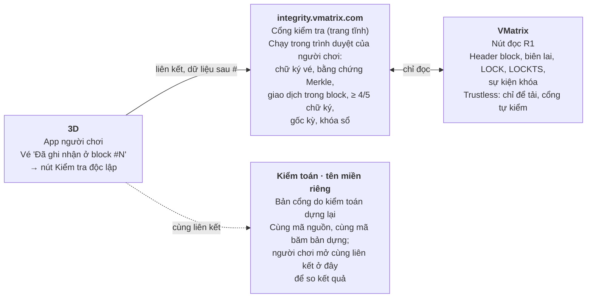
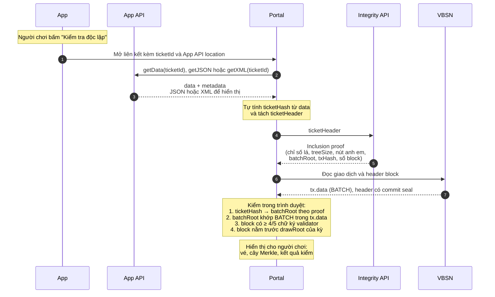
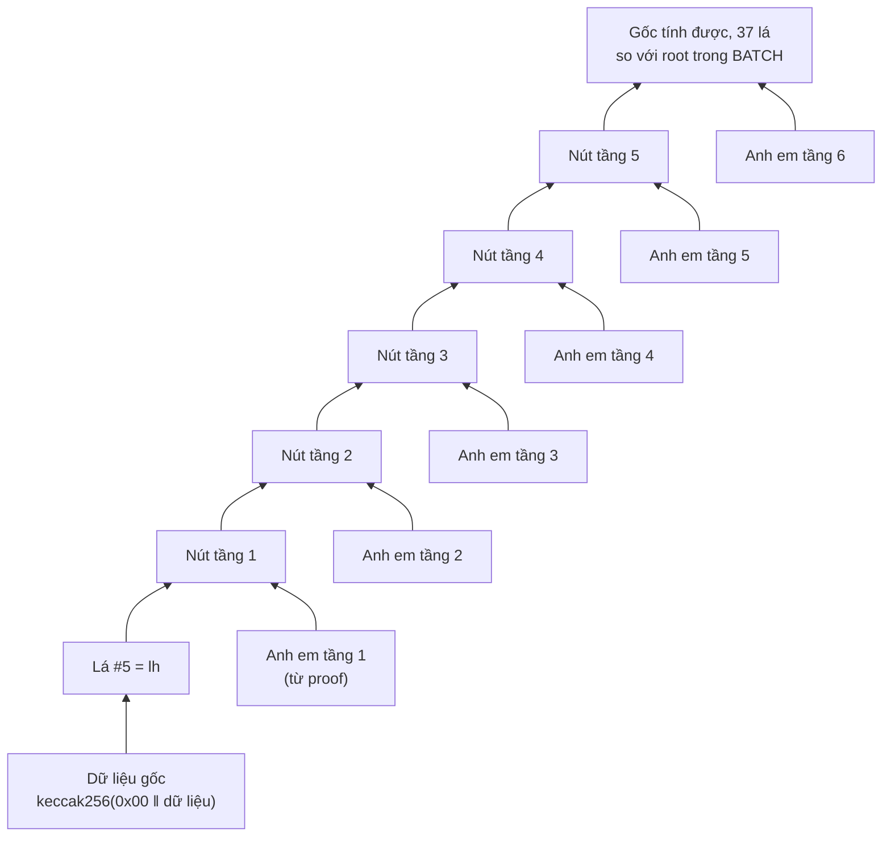

# 6. Cổng kiểm tra toàn vẹn dữ liệu (VMatrix)

**Người đề xuất:** Tuấn Anh · **Ngày:** 29/9/2026 · **Gửi:** anh Trung
**Phạm vi:** trang web kiểm tra vé và giao dịch neo trên VBSN, tách khỏi app 3D; do VMatrix dựng và vận hành tại `integrity.vmatrix.com`
**Tình trạng:** Đề xuất, chờ quyết định. Đối chiếu với trang giải pháp **bản 125** (28/9/2026): khớp ở trang kiểm tra tĩnh chạy trên trình duyệt, mã nguồn mở, bản dựng tái lập, mã băm bản dựng công bố, SRI, đọc chuỗi qua nút đọc công khai R1 của VMatrix, bản do kiểm toán dựng lại trên tên miền của kiểm toán. **Lệch:** bản 125 để 3D phục vụ trang kiểm tra (tên miền riêng trên hạ tầng web của 3D); đề xuất này chuyển bản chính sang VMatrix. Các chi tiết định dạng liên kết là đề xuất, chờ duyệt.

## 1. Vì sao tách khỏi app 3D

1. **Trustless với 3D.** Kết quả không phụ thuộc giao diện của bên đang bị kiểm tra. Nếu nút "Kiểm tra" chạy trong app 3D, người chơi chỉ thấy điều 3D cho thấy. Cổng ở `integrity.vmatrix.com`, mã nguồn mở, bản dựng tái lập, nên 3D không sửa được kết quả hiển thị.
2. **Cùng chỗ với dữ liệu gốc.** VMatrix vận hành VBSN và nút đọc R1; cổng đặt cạnh R1 nên đọc chuỗi nhanh, không đi qua hạ tầng 3D.
3. **Một cổng cho mọi đại lý.** Khi có thêm đường bán hoặc đại lý cấp II, cổng không đổi; mỗi bên chỉ cần tạo liên kết đúng định dạng.
4. **Trustless, kể cả với VMatrix.** Cổng kiểm chữ ký cam kết của block với danh sách validator ghim sẵn trong bản dựng (A5), nên R1 trả dữ liệu giả thì bằng chứng không khớp. Bản do kiểm toán dựng lại vẫn giữ như bản 125, để người chơi so kết quả giữa hai tên miền.



*Luồng kiểm tra qua cổng VMatrix.*

## 2. Vai trò

| Bên | Làm gì | Không làm |
|---|---|---|
| VMatrix | Dựng, vận hành cổng tại `integrity.vmatrix.com`; vận hành R1 với proxy chỉ mở phương thức đọc, giới hạn tần suất; công bố mã băm bản dựng | Không nhận dữ liệu vé; không có máy chủ ra kết luận |
| 3D | App tạo liên kết kiểm tra khi vé đã neo; xuất tập tin vé kèm bằng chứng; với gói lớn, mở API bằng chứng cho cổng gọi bằng mã truy cập ngắn hạn (mục 4.1); công bố đặc tả định dạng vé và bộ vector kiểm thử | Không phục vụ trang kiểm tra bản chính; không chèn mã vào cổng |
| Kiểm toán | Dựng lại cổng từ mã nguồn, đối chiếu mã băm, phục vụ ở tên miền của kiểm toán (bản 125) | — |
| Người chơi | Bấm liên kết, hoặc tải tập tin vé lên cổng, xem kết quả | Không cần tài khoản, không đăng nhập |

## 3. Luồng

| Bước | Diễn ra | Ghi chú |
|---|---|---|
| 1 | Vé chuyển "Đã ghi nhận ở block #N"; app hiện nút **Kiểm tra độc lập** | Chỉ hiện khi đã có bằng chứng neo |
| 2 | App mở trình duyệt hệ thống (không dùng webview trong app) tới liên kết cổng: dữ liệu commit và inclusion proof trong query, tập tin vé sau dấu `#` | Người chơi thấy đúng `integrity.vmatrix.com` trên thanh địa chỉ |
| 3 | Cổng đọc query và phần `#`, rồi xóa phần `#` khỏi thanh địa chỉ | Query lên máy chủ; phần `#` không |
| 4 | Cổng tự kiểm: chữ ký vé, bằng chứng Merkle, giao dịch trong block, tài khoản commit và khóa, chữ ký ≥ 4/5, gốc kỳ, khóa sổ trước giờ quay | 7 bước kiểm tra của người chơi (phần 1) |
| 5 | Cổng lấy header block, biên lai, bản ghi LOCK, LOCKTS và sự kiện khóa từ R1 | Chỉ phương thức đọc |
| 6 | Hiển thị dữ liệu gốc (nội dung giải mã và byte gốc), mã băm cổng tự tính, so với `lh` và `root`; kết quả từng bước, mã giao dịch, số block, thời điểm, 4/5 chữ ký, trạng thái kỳ; liên kết sang trình duyệt block | Có nút tải "gói bằng chứng" để kiểm offline |

Cách vào khác: người chơi tải tập tin vé (đã xuất từ app) lên cổng; xử lý hoàn toàn trên trình duyệt, không tải lên máy chủ.

### 3.1. Sơ đồ sequence: Portal lấy vé từ App API, bằng chứng từ Integrity API



Luồng theo phương án G (mục 4.1): liên kết chỉ mang mã tra cứu; Portal tự lấy dữ liệu vé từ App API và bằng chứng từ Integrity API, rồi đối chiếu với chuỗi. Bước 6–7 (Portal đọc VBSN) giữ cho việc kiểm là độc lập: kết quả vẫn đúng kể cả khi App API và Integrity API không trung thực.

- **`ticketId`:** dữ liệu bất kỳ mà mỗi App dùng để truy vấn hiệu quả dữ liệu vé của mình, mã hóa Base64. Với Portal, `ticketId` là chuỗi mờ (opaque): Portal không giải mã, không diễn giải, chỉ đẩy nguyên vào App API. Mỗi App tự chọn nội dung, ví dụ mã vé nội bộ, khóa tra cứu hay mã truy cập.
- **App nên làm `ticketId` khó đoán:** App API trả dữ liệu vé cho bất kỳ ai cầm `ticketId`, nên nếu `ticketId` chỉ là mã vé tuần tự thì có thể dò ra vé người khác. Gợi ý: App đưa vào `ticketId` một mã truy cập dùng một lần, hoặc mã hóa, ký tham chiếu vé; liên kết đặt `ticketId` sau dấu `#` để không vào nhật ký máy chủ của Portal; App API chỉ cho Portal gọi (CORS), như mục 4.1.
- **`App API location` trong liên kết:** Portal chỉ gọi tới địa chỉ nằm trong danh sách bên commit đã đăng ký (cấu hình của Portal, công bố cùng mã nguồn), không gọi địa chỉ lạ lấy từ liên kết; tránh liên kết giả trỏ Portal tới máy chủ của bên khác. Dữ liệu từ địa chỉ đó vẫn phải qua bước kiểm với chuỗi như mọi dữ liệu khác.
- **`ticketHeader` gửi sang Integrity API** chỉ nên gồm mã kỳ và `ticketHash` do Portal tự tính, không kèm dữ liệu nghiệp vụ của vé (ranh giới dữ liệu ở phần 11).

### 3.2. Đặc tả App API (đề xuất)

Mỗi bên commit (App) dựng App API tại địa chỉ đã đăng ký với Portal (`App API location`). Portal chỉ gọi ba hàm dưới đây, truyền nguyên `ticketId` nhận từ liên kết.

| Hàm | Vào | Ra | Portal dùng để |
|---|---|---|---|
| `getJSON` | `ticketId: base64` | JSON | Hiển thị nội dung vé theo trường, dễ đọc |
| `getXML` | `ticketId: base64` | XML | Hiển thị với App dùng XML làm định dạng gốc |
| `getData` | `ticketId: base64` | `data: base64` `metadata: JSON` | Lấy đúng byte đã commit để tự tính `ticketHash`; `metadata` cho biết cách đọc `data` |

**Byte để băm:** `ticketHash` phải tính trên đúng byte mà App đã băm khi commit. JSON và XML có thể đổi thứ tự trường, khoảng trắng, cách mã hóa ký tự mà nội dung vẫn như cũ, nên Portal **chỉ băm `data` của `getData`**; `getJSON` và `getXML` chỉ để hiển thị. Portal đối chiếu nội dung hiển thị với `data` đã giải mã khi định dạng cho phép, lệch thì báo.

**`metadata` tối thiểu (đề xuất):**

| Trường | Ý nghĩa |
|---|---|
| `format` | Định dạng của `data`: `cose`, `cbor`, `json`, `xml`, `binary`; với vé 3D là `cose` (COSE_Sign1) |
| `namespace` | Phạm vi khóa sổ, với 3D là mã kỳ (phần 11, mục 8) |
| `stream` | Dòng dữ liệu của bên commit (phần 11, mục 8) |
| `committer` | Mã bên commit đã đăng ký; Portal so với tài khoản ký giao dịch trên chuỗi |
| `display` | Tùy chọn: hàm nên dùng để hiển thị (`json` hoặc `xml`) |

`metadata` chỉ giúp Portal đọc và tra cứu; mọi trường trong đó vẫn phải khớp với dữ liệu trên chuỗi, Portal không tin `metadata` khi kiểm.

**Giao thức (đề xuất):**

- HTTPS, gọi bằng `POST` với `ticketId` trong thân yêu cầu, không đặt trong đường dẫn hay query, để `ticketId` không vào nhật ký máy chủ, proxy.
- CORS chỉ cho phép `https://integrity.vmatrix.com` và tên miền bản cổng của kiểm toán.
- App chỉ cần cài `getData` và một trong hai hàm hiển thị; Portal đọc `metadata.display` để chọn.
- Không có hàm liệt kê hay tìm kiếm; mỗi lần gọi chỉ trả đúng một vé của `ticketId`.

**Mã lỗi (đề xuất):**

| Trường hợp | Trả về | Portal hiển thị |
|---|---|---|
| `ticketId` sai định dạng hoặc không tồn tại | 404 | "Không tìm thấy dữ liệu" |
| `ticketId` hết hạn hoặc đã dùng (mã dùng một lần) | 410 | "Liên kết đã hết hạn, mở lại từ app" |
| Dữ liệu đã xóa theo yêu cầu người dùng hoặc hết thời hạn giữ (phần 5) | 410, kèm lý do | "Dữ liệu gốc không còn"; vẫn kiểm được nếu người dùng có tập tin vé |
| Gọi quá nhiều | 429 | "Thử lại sau" |

### 3.3. Đặc tả Integrity API: `batchHeader`, `ticketHeader` (đề xuất)

`batchHeader` là dữ liệu bên commit gửi khi ghi một lô (BATCH, phần 11); `ticketHeader` là dữ liệu Portal gửi để lấy inclusion proof của một vé. Cả hai chỉ chứa mã băm và số liệu định vị, không chứa nội dung vé.

**`batchHeader`**

| Trường | Kiểu | Bắt buộc | Mô tả |
|---|---|---|---|
| `draw` | `string` | có | Mã kỳ, không rỗng |
| `channel` | `string` | có | Kênh bán |
| `sequence` | `uint64` | có | Số thứ tự của vé đầu tiên trong lô |
| `timestamp` | `uint64` | có | Thời điểm của vé đầu tiên trong lô; đề xuất mili giây Unix, UTC |
| `ticketHashes` | `bytes32[]` | có | Các lá theo thứ tự: 1 đến 100.000 phần tử, khác 0, không lặp |
| `value` | `uint64` | có | Tổng giá trị của lô, theo đơn vị bên commit dùng |

- `count` = số phần tử của `ticketHashes`; dịch vụ tự tính, không nhận từ bên commit.
- Vé thứ k trong lô (đếm từ 0) có số thứ tự `sequence + k`; lô kế tiếp trên cùng `channel` phải có `sequence` = `sequence + count` của lô này (phần 11, mục 6). Dịch vụ từ chối lô sai, trả về `sequence` mong đợi.
- `timestamp` không thay cho thời điểm block hay dấu thời gian RFC 3161; chỉ dùng để tra cứu và để kiểm `timestamp` không giảm giữa các lô trên cùng `channel`.

**`ticketHeader`**

| Trường | Kiểu | Bắt buộc | Mô tả |
|---|---|---|---|
| `draw` | `string` | có | Mã kỳ của vé |
| `channel` | `string` | có | Kênh bán của vé |
| `sequence` | `uint64` | có | Số thứ tự của vé |
| `timestamp` | `uint64` | có | Thời điểm của vé, cùng đơn vị với `batchHeader` |
| `ticketHash` | `bytes32` | có | Lá của vé, Portal tự tính từ `data` của `getData` |

**Integrity API định vị vé bằng `ticketHeader`:**

1. Tìm BATCH cùng `draw`, `channel` có `sequence ≤ s < sequence + count`, với `s` là `sequence` của vé; `timestamp` dùng để thu hẹp tìm kiếm.
2. Chỉ số lá = `s − sequence` của lô; lá tại chỉ số đó phải bằng `ticketHash`, không bằng thì trả 404.
3. Trả inclusion proof: chỉ số lá, `treeSize`, các nút anh em, `batchRoot`, `count`, `value`, `txHash`, số block.

Nhờ `sequence`, việc tra cứu là O(1) theo chỉ mục, không cần bảng tra theo mã băm. Portal vẫn tự kiểm proof với chuỗi; Integrity API trả sai thì bước kiểm ở Portal báo lỗi.

## 4. Liên kết kiểm tra (đề xuất, chờ duyệt)

`https://integrity.vmatrix.com/v1/?tx=…&block=…&i=…&n=…&lh=…&p=…#t=…`

Dữ liệu commit và inclusion proof đi qua **query**; tập tin vé đi sau **`#`**. Query chỉ có mã băm và số thứ tự, không có dữ liệu cá nhân, nên đi lên máy chủ được. Tập tin vé có bộ số và các mã băm giả danh, nên không đưa vào query.

| Tham số | Vị trí | Nội dung | Vì sao để đây |
|---|---|---|---|
| `tx`, `block` | Query | Mã giao dịch chứa BATCH, số block | Cổng lấy giao dịch, biên lai, header từ R1 |
| `i`, `n` | Query | Chỉ số lá, `treeSize` của lô | Cổng tự suy ra thứ tự trái/phải của từng tầng theo RFC 9162 |
| `lh` | Query | Mã băm lá `keccak256(0x00 ‖ vé)` | Chỉ là mã băm; không dò ngược được ra vé |
| `p` | Query | Các nút anh em từ lá tới gốc lô, nối liền, base64url | Khoảng 6–20 nút × 32 byte |
| `dp` | Query | Bằng chứng từ gốc lô tới `finalRoot` | Chỉ có sau khóa sổ |
| `t` | Sau `#` | Tập tin vé: lõi COSE_Sign1 đã ký, base64url | Có bộ số, `holder_commit`; không lên máy chủ, không vào nhật ký, proxy, Referer |

- **Dữ liệu gốc đã commit phải vào cổng:** tập tin vé (`t`) là dữ liệu gốc mà 3D đã băm thành lá. Cổng nhận nó qua phần sau `#`, tự tính `keccak256(0x00 ‖ dữ liệu gốc)`, so với `lh` rồi đi tiếp inclusion proof tới `root` trong BATCH, và hiển thị cả nội dung giải mã lẫn byte gốc để người chơi tự xem. Cổng trustless với `lh` do app gửi: lá dùng để chạy proof là lá cổng tự tính từ dữ liệu gốc.
- **Chỉ có query vẫn kiểm được phần commit:** lá `lh` có trong lô đã commit, lô nằm trong block có 4/5 chữ ký. Có thêm phần `#` thì cổng kiểm tiếp chữ ký 3D trên vé và lá tính từ vé đúng bằng `lh`, tức vé đang xem đúng là vé đã commit.
- **Không đưa tập tin vé vào query:** query đi vào nhật ký máy chủ, CDN, proxy và tiêu đề Referer; tập tin vé có bộ số và mã băm giả danh của người chơi. Nếu buộc phải gửi vé lên máy chủ thì dùng POST trong thân yêu cầu, không dùng query.
- **Nhật ký máy chủ:** VMatrix không ghi query vào nhật ký truy cập, hoặc giữ ngắn; ghi vào điều khoản vận hành cổng.
- **Không cần ký liên kết:** mọi tham số đều tự kiểm được; sửa bất kỳ tham số nào thì kết quả báo không khớp.
- **Độ dài:** query khoảng 400–800 ký tự, phần `#` khoảng 300–700 ký tự; trong giới hạn của trình duyệt. QR in trên vé theo bản 125 (điểm 25, chờ chốt tên miền tra cứu).
- **Phần `#`:** cổng xóa khỏi thanh địa chỉ và lịch sử trình duyệt ngay sau khi đọc.

### 4.1. Khi dữ liệu quá lớn cho liên kết (đề xuất, chờ duyệt)

Một vé kèm proof chỉ khoảng 1–2 KB. Liên kết vượt giới hạn khi người chơi kiểm cả một đơn nhiều vé, hoặc khi tổ chức khác gửi dữ liệu gốc lớn (PDF, ảnh). Giới hạn thực tế nằm ở ba chỗ:

| Chỗ giới hạn | Mức | Áp dụng cho |
|---|---|---|
| Máy chủ, CDN đọc dòng yêu cầu | nginx mặc định 8 KB cho một dòng yêu cầu, quá thì trả 414 | Query (đi lên máy chủ); phần `#` không đi lên máy chủ |
| App gọi trình duyệt (Android) | Bộ đệm Binder 1 MB dùng chung cho cả tiến trình; Android khuyên chỉ truyền vài KB qua Intent | Toàn bộ liên kết app mở |
| Trình duyệt | Chrome giới hạn URL 2 MB, thanh địa chỉ chỉ hiển thị 32 KB; iOS chưa có con số công bố, cần đo | Toàn bộ liên kết |

**Các phương án**, xếp theo mức phụ thuộc backend từ thấp tới cao. Mọi phương án đều giữ cùng một cách kiểm: cổng tự băm và đối chiếu với chuỗi, nên nguồn dữ liệu chỉ ảnh hưởng tính sẵn sàng, không ảnh hưởng kết quả.

| Phương án | Cách làm | Kích thước | Tức thời | Backend | Trustless |
|---|---|---|---|---|---|
| A. Nén vào phần `#` | Gói query và dữ liệu gốc thành một khối CBOR, nén `deflate-raw`, base64url, đặt sau `#`; cổng giải nén bằng `DecompressionStream` (Chrome 80, Firefox 113, Safari 16.4 trở lên). Proof của nhiều vé cùng lô gộp nút anh em chung | An toàn tới khoảng 8 KB sau mã hóa; trên mức đó rủi ro ở Android Intent và iOS | Có | Không | Giữ nguyên |
| B. Mở từ web 3D, chuyển bằng `postMessage` | Chỉ cho đường web (W): trang 3D mở cổng bằng `window.open`, cổng báo sẵn sàng, trang 3D gửi dữ liệu qua `postMessage` chỉ tới `https://integrity.vmatrix.com` | Không giới hạn thực tế | Có | Không | Giữ nguyên: trang 3D không đọc, không sửa được giao diện cổng khác tên miền |
| C. Gói bằng chứng dạng tệp | App xuất tệp gói bằng chứng qua bảng chia sẻ hoặc Tệp; người chơi mở cổng, chọn hoặc kéo thả tệp. Android có thể chia sẻ thẳng tệp vào cổng nếu cổng là PWA khai báo `share_target` (Chrome, Edge; Safari và Firefox chưa hỗ trợ) | Không giới hạn thực tế | Không: thêm 1–2 thao tác (Android PWA: 1 chạm) | Không | Giữ nguyên; kiểm được ngoại tuyến |
| D. QR động sang máy khác | Điện thoại hiện chuỗi mã QR, cổng trên máy tính quét bằng camera và ráp lại | Vài KB tới vài chục KB, tốc độ vài KB/giây | Vài giây | Không | Giữ nguyên |
| G. Cổng lấy từ indexer, backend của bên commit | Dữ liệu gốc và proof vốn đã nằm ở indexer Merkle và cơ sở dữ liệu vé của 3D (phần 7). Liên kết chỉ mang tham chiếu ngắn và một mã truy cập dùng một lần, ngắn hạn, sau `#`; cổng gọi thẳng API bằng chứng của 3D từ trình duyệt (CORS chỉ cho `integrity.vmatrix.com`), rồi tự kiểm như mọi phương án khác | Không giới hạn thực tế; liên kết chỉ khoảng 100–200 ký tự | Có | Có, nhưng là backend sẵn có của bên commit, không thêm dịch vụ mới; dữ liệu đi thẳng từ 3D tới trình duyệt, máy chủ VMatrix không thấy | Giữ nguyên: 3D chỉ quyết được có trả dữ liệu hay không, không làm sai được kết quả kiểm vì mọi mã băm phải khớp `root` trên chuỗi |
| E. Kho tạm mã hóa | App sinh khóa AES-256-GCM ngẫu nhiên, mã hóa gói, tải bản mã lên kho tạm; liên kết mang mã kho trong query và khóa sau `#`; cổng tải bản mã, giải mã bằng WebCrypto | Tới vài MB (trần do kho đặt) | Có | Có, nhưng chỉ là kho lưu bản mã: không đọc được dữ liệu, giữ ngắn hạn (khoảng 10 phút) | Giữ nguyên: kho chỉ ảnh hưởng tính sẵn sàng, không ảnh hưởng kết quả kiểm |
| ~~F. WebView trong app, tiêm dữ liệu qua cầu nối JS~~ | App kiểm soát WebView nên sửa được giao diện cổng | Không giới hạn | Có | Không | **Mất trustless**: không dùng |

**Đề xuất:** dùng theo bậc, app tự chọn theo kích thước gói.

1. **Gói ≤ khoảng 8 KB sau mã hóa:** phương án A. Gần như mọi trường hợp của vé 3D; không phụ thuộc ai, kiểm được cả khi 3D ngừng dịch vụ.
2. **Lớn hơn, cần tức thời:** phương án G. Dữ liệu đã nằm sẵn ở 3D nên không cần thêm dịch vụ; khi 3D không trả lời, cổng báo rõ "bên commit không phản hồi" và gợi ý dùng tệp gói bằng chứng (C).
3. **Bên commit không có API bằng chứng** (nghiệp vụ chung): phương án E, kho tạm mã hóa do VMatrix chạy cùng tên miền với cổng; chỉ nhận bản mã, có trần kích thước, tự xóa khi hết hạn.
4. **Đường web của 3D:** phương án B thay cho A, G và E.
5. **Ngoại tuyến hoặc rất lớn:** phương án C; máy tính kiểm thay điện thoại: phương án D.

**API bằng chứng của bên commit (phương án G, chờ duyệt):** một đặc tả chung cho mọi tổ chức, để cổng gọi được mà không cần mã riêng cho từng bên.

| Mảng | Yêu cầu |
|---|---|
| Địa chỉ | Mỗi tổ chức công bố địa chỉ API bằng chứng; cổng lấy từ danh bạ tổ chức đăng ký qua quản trị (phần 8), không lấy từ liên kết, để liên kết giả không dẫn cổng tới máy chủ lạ |
| Truy cập | Mã truy cập dùng một lần, hết hạn sau vài phút, gắn với một vé hoặc một đơn; app xin mã từ backend 3D khi người chơi bấm kiểm; mã nằm sau `#` nên không vào nhật ký máy chủ VMatrix |
| Trả về | Gói bằng chứng giống hệt phương án A (dữ liệu gốc, lá, proof, giao dịch, block, `draw_proof`), có thể nén |
| CORS | Chỉ cho `https://integrity.vmatrix.com` và tên miền bản cổng của kiểm toán |
| Riêng tư | Chỉ trả đúng vé hoặc đơn của mã truy cập; không có API liệt kê; ghi nhật ký truy cập theo phần 5 |
| Khi bên commit đã xóa dữ liệu (phần 5) | Trả "không còn dữ liệu"; người chơi dùng tệp gói bằng chứng đã lưu |

Kèm theo: chuyển phần query vào khối nén sau `#` khi dùng A, và chỉ giữ tham chiếu ngắn khi dùng G, vì cổng là trang tĩnh, máy chủ không cần đọc query; chỉ giữ query khi có lý do vận hành (ví dụ thống kê lượt kiểm theo tổ chức).

## 5. Mockup

### 5.1. Nghiệp vụ 3D: vé điện tử

Mockup chạy trên trình duyệt, **dữ liệu giả lập**. Chỉ việc băm dữ liệu gốc, đi qua 6 tầng inclusion proof và so với `root` của BATCH là tính thật bằng keccak256 ngay trên trang. Mã giao dịch, block, chữ ký block, tài khoản và chữ ký 3D là giả lập. Bản gốc có nút "Chạy lại kiểm tra", "Thử sửa 1 byte của vé" (để thấy kết quả khi dữ liệu bị sửa) và "Khôi phục dữ liệu gốc".

```text
┌──────────────────────────────────────────────────────────────────────────┐
│ https://integrity.vmatrix.com/v1/?tx=0x…&block=2847391&i=5&n=37          │
│   &lh=0x…&p=…                #t=…                                        │
│   └──── query: lên máy chủ ────┘  └ sau #: chỉ ở trình duyệt ┘            │
├──────────────────────────────────────────────────────────────────────────┤
│ VBSN Integrity · integrity.vmatrix.com · Mẫu thiết kế · dữ liệu giả lập  │
│ Kết quả: đang kiểm… → từng bước ✓ / ⚠ / chờ                              │
│                                                                          │
│ [1] Dữ liệu gốc đã commit (tập tin vé nhận qua phần sau #)               │
│     Nội dung giải mã (COSE_Sign1 → lõi CBOR)                             │
│     Xem byte gốc (hex)         ← có thể sửa để thử                       │
│     Cổng tính: 0x781641b8…e8c936     lh trong query: 0x781641b8…e8c936   │
│                                                                          │
│ [2] Commit trên chuỗi · đọc từ R1 theo tx                                │
│     Giao dịch · Block · Gửi từ · Chữ ký block V1 V2 V3 V4 V5             │
│     Bản ghi BATCH (giải mã từ tx.data)  ·  tx.data (nguyên văn)          │
│                                                                          │
│ [3] Inclusion proof · cây Merkle, RFC 9162, keccak256                    │
│     Vị trí lá: i = 5 / n = 37  ·  Xem từng bước tính                     │
│                                                                          │
│ [4] Giao dịch trong block                                                │
│     Chờ đặc tả API commit bằng chứng Merkle-Patricia                     │
│     từ biên lai tới receiptsRoot của header block #2847391               │
├──────────────────────────────────────────────────────────────────────────┤
│ Bản dựng: keccak256 7d0e…41b2 (mô phỏng) · So kết quả với bản của        │
│ kiểm toán · Không cookie · không công cụ phân tích                       │
└──────────────────────────────────────────────────────────────────────────┘
```

**Nội dung giải mã của vé mẫu**

| Trường | Giá trị |
|---|---|
| Mã vé Vietlott | `MG-01453-7F2K-90341` |
| Loại chứng từ | `VE_XSDT_DIEN_TU` · v1 |
| Sản phẩm, kỳ | `MEGA645` · `01453` |
| Bộ số | 03 · 12 · 21 · 34 · 39 · 44 |
| Giá | 10.000 đ |
| Kênh | `INT-M` |
| `holder_commit` | mã băm 32 byte |
| Chữ ký 3D | ES256, mô phỏng |

**Commit trên chuỗi (giả lập)**

| Trường | Giá trị |
|---|---|
| Block | #2847391 · 2026-11-04 13:42:09 ICT |
| Gửi từ | `0x3d0e…a91c` (tài khoản commit của 3D) |
| Chữ ký block | V1 V2 V3 V4 V5 |

**Bản ghi BATCH giải mã từ `tx.data`**

| Trường | Giá trị |
|---|---|
| `type` | `BATCH` |
| `channel` | `M` |
| `seq` | 418207 |
| `prevHead` | mã băm 32 byte |
| `root` | `0x93d36071…921bfa` (được so với gốc cổng tính) |
| `treeSize` | 37 |
| `draws` | `MEGA-01453` |
| `count` | 37 |
| `totalValue` | 370.000 đ |
| `keyId` | `3d-write-2026Q4-a` |

**Tám bước kiểm của mockup**

| # | Bước | Trạng thái trong mockup |
|---|---|---|
| 1 | Dữ liệu gốc băm ra đúng `lh` trong query | Tính thật |
| 2 | Inclusion proof từ lá ra đúng `root` của BATCH | Tính thật |
| 3 | `root` nằm trong `tx.data` của giao dịch | Tính thật |
| 4 | Chữ ký 3D trên dữ liệu gốc hợp lệ | Giả lập |
| 5 | Giao dịch nằm trong block | Chờ đặc tả |
| 6 | Block có 4/5 chữ ký validator đã ghim | Giả lập |
| 7 | Gửi từ tài khoản commit 3D, khóa chưa thu hồi | Giả lập |
| 8 | Kỳ 01453 khóa sổ trước giờ quay | Chờ đặc tả |

**Nhánh cây Merkle của bằng chứng** (lá thứ 5 của 37 lá, 6 tầng; mỗi tầng một nút anh em lấy từ proof):




### 5.2. Nghiệp vụ chung: dữ liệu bất kỳ (đề xuất)

Mockup chạy trên trình duyệt, **dữ liệu giả lập**. Cổng chỉ băm đúng từng byte dữ liệu gốc, đi qua inclusion proof và so với `root` của BATCH bằng keccak256 thật trên trang. Tổ chức, tài khoản, giao dịch, block, chữ ký block là giả lập. Thử "Tải tệp lên" với một tệp bất kỳ hoặc sửa nội dung ở "Dán nội dung": mã băm sẽ khác `lh` và kết quả báo không khớp.

```text
┌──────────────────────────────────────────────────────────────────────────┐
│ https://integrity.vmatrix.com/v1/?org=…&tx=0x…&block=2851006&i=9&n=23    │
│   &lh=0x…&p=…                #ct=…&d=…                                   │
│   └──── query: lên máy chủ ────┘  └ sau #: chỉ ở trình duyệt ┘            │
├──────────────────────────────────────────────────────────────────────────┤
│ [1] Dữ liệu gốc đã commit · cổng không cần biết cấu trúc, chỉ băm        │
│     đúng từng byte                                                       │
│     Nguồn:  (•) Từ liên kết (#)   ( ) Tải tệp lên   ( ) Dán nội dung     │
│     Hiển thị: Dạng trường | JSON gốc · Xem byte gốc (hex)                │
│     Cổng tính: 0x…            lh trong query: 0x…                        │
│                                                                          │
│ [2] Commit trên chuỗi · đọc từ R1 theo tx                                │
│     Tổ chức commit: ORG-0042 · Công ty mẫu A (giả lập)                   │
│     Tài khoản: 0x42a7…9e01 · đăng ký qua sự kiện quản trị khóa           │
│     Giao dịch · Block #2851006 · 2026-09-29 09:14:07 ICT                 │
│     Chữ ký block V1 V2 V3 V4 V5 · Bản ghi BATCH · tx.data                │
│                                                                          │
│ [3] Inclusion proof · RFC 9162, keccak256 · i = 9 / n = 23               │
│                                                                          │
│ [4] Giao dịch trong block: chờ đặc tả API commit bằng chứng              │
│     Merkle-Patricia tới receiptsRoot của header block #2851006           │
├──────────────────────────────────────────────────────────────────────────┤
│ Bản dựng: keccak256 7d0e…41b2 (mô phỏng) · So kết quả với bản của        │
│ kiểm toán · Không cookie · không công cụ phân tích                       │
└──────────────────────────────────────────────────────────────────────────┘
```

**Dữ liệu gốc mẫu** (376 byte JSON; `contentHash` là mã băm 32 byte):

```json
{"contentHash":"0x…","docId":"DOC-2026-004218","docType":"bien-ban-nghiem-thu","issuedAt":"2026-09-29T09:14:05+07:00","issuer":"ORG-0042","items":[{"code":"HM3-01","qty":12,"unit":"bộ"},{"code":"HM3-02","qty":4,"unit":"bộ"}],"schema":"vbsn.record/v1","title":"Biên bản nghiệm thu hạng mục 3 (mẫu)"}
```

**Bản ghi BATCH giải mã từ `tx.data`**

| Trường | Giá trị |
|---|---|
| `type` | `BATCH` |
| `org` | `ORG-0042` |
| `stream` | `records` |
| `seq` | 90114 |
| `prevHead` | mã băm 32 byte |
| `root` | mã băm 32 byte (được so với gốc cổng tính) |
| `treeSize` | 23 |


Cổng dùng chung cho mọi tổ chức commit dữ liệu lên VBSN, không chỉ vé của 3D. Mô hình giống hệt: tổ chức gom bản ghi thành lô, commit gốc lô trong bản ghi BATCH từ tài khoản đã đăng ký; người cần kiểm nhận liên kết hoặc tự có tệp gốc.

| Khác với nghiệp vụ 3D | Nghiệp vụ chung |
|---|---|
| Dữ liệu gốc | Byte bất kỳ: JSON, văn bản, PDF, ảnh…; cổng không cần biết cấu trúc, chỉ băm đúng từng byte |
| Lá | `keccak256(0x00 ‖ dữ liệu gốc)`, cùng cấu trúc RFC 9162 |
| Tham số thêm | `org` (mã tổ chức) trong query; `ct` (kiểu nội dung, chỉ để hiển thị) và `d` (dữ liệu gốc) sau `#` |
| Cách đưa dữ liệu gốc vào | Từ liên kết, tải tệp lên hoặc dán nội dung; tệp đọc và băm trên trình duyệt, không tải lên máy chủ |
| Danh tính bên commit | Tài khoản commit của tổ chức, công bố qua sự kiện quản trị khóa; cổng hiển thị tên tổ chức theo danh bạ công khai của VMatrix |
| Chữ ký riêng trên dữ liệu | Không bắt buộc; nếu tổ chức có chữ ký riêng (như COSE của 3D) thì cổng kiểm thêm theo đặc tả tổ chức công bố |
| Dữ liệu lớn | Tệp lớn không đưa vào liên kết; người kiểm tải tệp lên cổng, liên kết chỉ mang phần query |

## 6. Yêu cầu với cổng

| Mảng | Yêu cầu |
|---|---|
| Kiến trúc | Trang tĩnh, không có máy chủ ra kết luận; thư viện kiểm tra dùng chung với bản của kiểm toán và bộ vector kiểm thử của 3D |
| Toàn vẹn bản dựng | Mã nguồn mở, bản dựng tái lập; mã băm bản dựng công bố trên VBSN và website các bên; SRI cho mọi tệp nạp (bản 125) |
| Tin cậy dữ liệu chuỗi | Danh sách validator genesis ghim trong bản dựng; mỗi thay đổi validator kiểm bằng bản mốc có chữ ký ≥ 4/5 (A5); không dựa vào kết quả truy vấn của R1 |
| Riêng tư | Không cookie, không công cụ phân tích, không tài nguyên bên thứ ba; CSP chặt; dữ liệu vé chỉ nằm trong trình duyệt |
| Chống giả mạo | HSTS; app chỉ mở đúng tên miền đã ghim; cổng hiển thị tên miền và mã băm bản dựng; hướng dẫn người chơi so với bản của kiểm toán |
| Thời gian | ≤ 3 giây p95 khi trực tuyến (bản 125, mục Xác minh); kiểm offline với gói bằng chứng đã lưu |
| Tải | R1 giới hạn tần suất; cổng lưu tạm header block đã chốt vì block QBFT không đảo ngược |

## 7. Dữ liệu cá nhân

- Tập tin vé không rời trình duyệt, nên VMatrix không nhận dữ liệu vé qua cổng; máy chủ chỉ thấy query gồm mã băm và số thứ tự. Pháp chế cần xác nhận khi đó VMatrix không là bên xử lý dữ liệu cá nhân của vé theo Luật Bảo vệ dữ liệu cá nhân số 91/2025/QH15.
- Cổng vẫn hỏi R1 theo mã giao dịch và số block, nên R1 thấy địa chỉ IP gắn với một block. Một block chứa lô của nhiều vé nên không lộ vé cụ thể; giảm thêm bằng cách lấy cả dải block quanh block cần kiểm **(tùy chọn)**.
- Sau khi 3D xóa dữ liệu nhận dạng (phần 5), liên kết và tập tin vé người chơi đã lưu vẫn kiểm được, vì cổng không cần dữ liệu của 3D.

## 8. Rủi ro và điểm còn mở

1. **Lệch bản 125 về bên phục vụ trang kiểm tra:** cần anh Trung quyết định; nếu giữ 3D phục vụ, phần còn lại của đề xuất vẫn dùng được với tên miền của 3D.
2. **VMatrix đồng ý dựng và vận hành cổng:** đưa vào hợp đồng dịch vụ 3D–VMatrix (chưa ký), gồm SLA, giới hạn tần suất R1, quy trình cập nhật bản dựng.
3. **Bằng chứng giao dịch trong block:** phụ thuộc đặc tả API commit của VMatrix (dự kiến bằng chứng Merkle-Patricia trong `receiptsRoot` hoặc `transactionsRoot`, bản 125).
4. **Tên miền:** cổng dùng `integrity.vmatrix.com`; tên miền tra cứu trên QR vé chờ chốt (bản 125, điểm 25), nên thống nhất về cùng địa chỉ.
5. **Trang giả mạo:** người chơi có thể bị dẫn tới cổng giả báo "hợp lệ"; giảm bằng tên miền ghim trong app, hướng dẫn so với bản của kiểm toán, mã băm bản dựng công bố.
6. **Định dạng liên kết:** các tham số ở mục 4 là đề xuất, chờ duyệt cùng đặc tả định dạng vé.
7. **Dữ liệu lớn (mục 4.1):** chốt ngưỡng chuyển từ A sang G sau khi đo trên Android và iOS; đặc tả chung API bằng chứng của bên commit; VMatrix có chạy kho tạm mã hóa (E) cho tổ chức không có API hay không.
